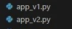
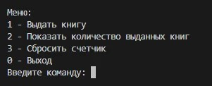
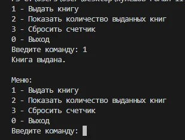
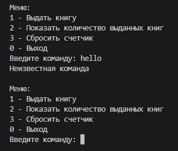

# Проект Учет книг

## Описание проекта

Простая консольная программа на языке Python для учета выданных книг в библиотеке. 

В проекте есть две версии программы: первая версия **app_v1.py** (выдача книг, просмотр количества, сброс счетчика) и вторая версия **app_v2.py** (добавлена возможность возврата книги).

## Как запустить программу

1. Убедитесь, что у вас установлен Python
2. Скачайте файлы с репозитория



3. Введите в консоль команду для запуска первой версии

```bash
python .\app_v1.py
```

или для запуска второй версии

```bash
python .\app_v2.py
```

## Как пользоваться меню



После запуска на экране появится список доступных действий. Введите нужную цифру и нажмите Enter:

1. Выдать книгу (увеличивает счетчик на 1, работает в app_v1.py и app_v2.py).
2. Показать количество выданных книг (выводит текущее значение счетчика, работает в app_v1.py и app_v2.py).
3. Сбросить счетчик (обнуляет количество выданных книг, работает в app_v1.py и app_v2.py).
4. Вернуть книгу (уменьшает счетчик на 1, работает только в app_v2.py).
0. Выход (завершает работу программы, работает в app_v1.py и app_v2.py).

Если ввести любую другую букву, цифру или оставить строку пустой, обе программы предупредят о неизвестной команде и снова покажут меню.

## Скриншоты работы

Пример выдачи и возврата книги в консоли:



Пример обработки неверного ввода и попытки вернуть книгу при нулевом счетчике:


